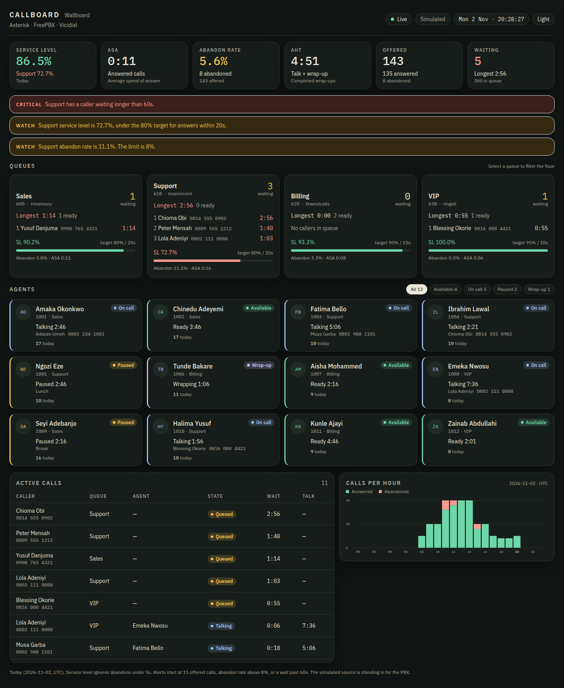
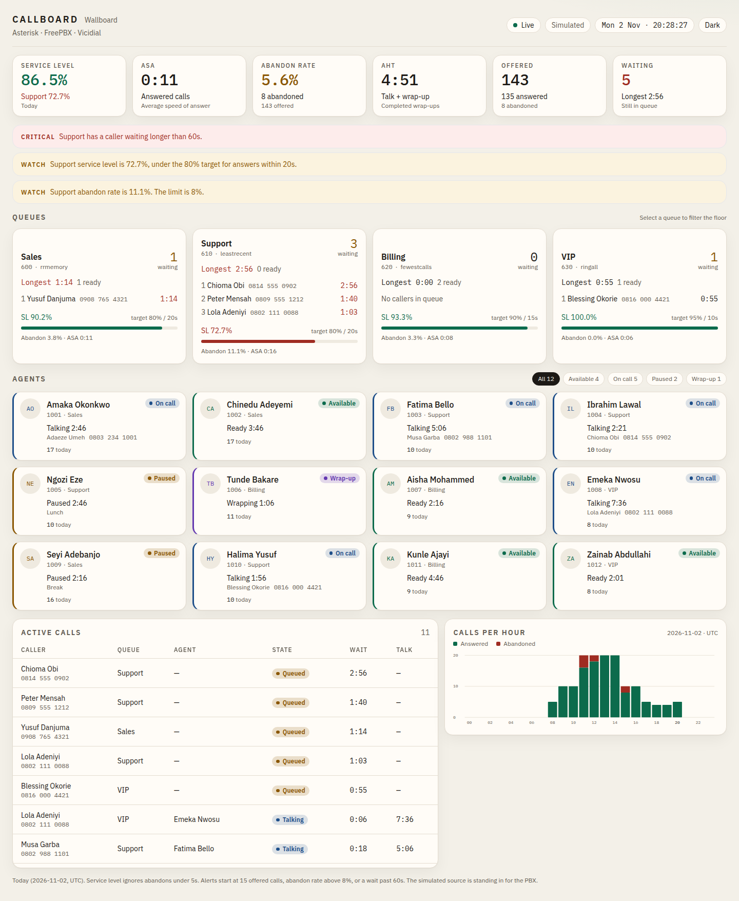
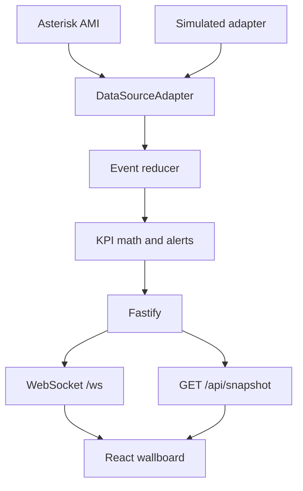

# Callboard

[](https://github.com/maikama8/voip-call-center-dashboard-modern/actions/workflows/ci.yml)

A queue floor is hard to read from a CLI. Callboard is a real-time wallboard for that floor: who is available, who is in wrap-up, which queue is missing its service level, and which caller has been waiting too long.

It is a portfolio project. Live updates come from a data-source adapter. The default adapter is simulated, so the API, the tests, the UI, and Docker start with no PBX. An Asterisk Manager (AMI) adapter speaks the same events and is selected with one environment variable.





The screenshots are the simulated source. Support is under its 80% / 20 second target, a caller has been waiting past the watch limit, and Sales, Billing, and VIP are inside theirs. Nothing in those pictures was drawn by hand: it is the opening state the process serves.

## Features

- Live agent board: available, on call, paused (with a reason), and wrap-up.
- Queues with the callers still waiting, a ticking longest-wait, and a service-level bar against the target.
- Active calls: queued, talking, and wrap-up, with wait and talk timers.
- KPIs for the day: service level, average speed of answer (ASA), abandon rate, and average handle time (AHT).
- Calls per hour, split into answered and abandoned.
- Alerts when a queue misses its service level, its abandon-rate limit, or its wait limit.
- Dark and light themes. The choice is remembered in the browser.
- Click a queue to filter the agents and the call list. Filter agents by status.
- WebSocket updates, with a snapshot over HTTP if the socket has not opened yet.
- AMI login, `QueueStatus`, and the queue and agent events that follow. Reconnects on its own.

The simulated floor is a fixed day plus a small amount of motion. It is there so the board, the formulas, and the tests can run with the network switched off. It is not a forecast.

## Tech stack

- Node.js 22
- [Fastify](https://fastify.dev/) 5, with WebSockets
- React 19, TypeScript, [Vite](https://vite.dev/), [Tailwind CSS](https://tailwindcss.com/)
- [Vitest](https://vitest.dev/) and ESLint
- Docker

## Architecture



Both adapters emit the same events. `reduce` is a pure function from the previous floor plus one event. The KPI functions read the outcomes and the callers still waiting. Routes and the socket only see the snapshot, so the UI does not know whether the events came from AMI or from the simulator.

The browser keeps its own clock for wait, talk, and wrap-up. Those timers move every second. Service level, ASA, abandon rate, and AHT change when a call ends.

## Getting started

Requires Node.js 22.

```bash
git clone https://github.com/maikama8/voip-call-center-dashboard-modern.git
cd voip-call-center-dashboard-modern
npm install
cp .env.example .env
npm run dev
```

- Wallboard, with the API proxied: `http://127.0.0.1:5173`
- API: `http://127.0.0.1:8080`
- Health: `http://127.0.0.1:8080/api/health`

`npm run dev` starts the API and Vite together. `make dev`, `make test`, `make lint`, and `make build` wrap the same scripts.

To serve the built UI from the API:

```bash
npm run build
npm start
```

The wallboard is then at `http://127.0.0.1:8080`.

### Docker

```bash
docker compose up --build
```

The image listens on port 8080 and defaults to the simulated source. An empty `.env` copied from `.env.example` is enough. Compose reads the variables it interpolates from the shell or from that file, and it starts without one.

`127.0.0.1` inside the container is the container, not the PBX. For AMI, set `AMI_HOST` to the PBX address.

## Asterisk and Vicidial

`DATA_SOURCE=ami` connects to Asterisk Manager, sends `Login`, `QueueStatus`, and `Ping`, and maps queue and agent events into the same reducer the simulator uses. The manager user, the event table, FreePBX, and the Vicidial status map are in [docs/asterisk-ami.md](docs/asterisk-ami.md). A copy-paste user is in [docs/manager.conf](docs/manager.conf).

The adapter does not send `Originate`, `Hangup`, or `Command`. Give the manager user `agent` read and `agent` write (`QueueStatus` needs the write class) and keep `permit` on the dashboard host. AMI is cleartext unless you turn on TLS.

Two figures sit next to each other in AMI mode:

- **Since connect** — service level, ASA, abandon rate, and AHT from events this process has seen. A restart starts them over.
- **PBX** — Asterisk's own `ServicelevelPerf`, hold time, talk time, completed, and abandoned, from `QueueParams`, since the queue was loaded. They are labelled on the queue card and are not copied into the observed KPIs. Asterisk's ratio and this board's ratio are not the same formula.

Vicidial outbound agents are not Asterisk queue members. They will not appear through this AMI adapter. Inbound groups that are real queues will. The `vicidial_live_agents` mapping (READY, INCALL, PAUSED, DISPO, and the rest) is documented for a later adapter. The simulated board already uses the same four states.

## Configuration

Settings are read from the environment and from a `.env` file in the repo root. Existing environment variables win. See `.env.example` for the full list.

| Variable | Default | Purpose |
| --- | --- | --- |
| `DATA_SOURCE` | `simulated` | `simulated` or `ami` |
| `HOST` | `0.0.0.0` | Bind address |
| `PORT` | `8080` | HTTP and WebSocket port |
| `TIMEZONE` | `UTC` | IANA zone for "today", the chart, and the clock |
| `LOG_LEVEL` | `info` | Fastify log level |
| `WEB_DIST` | `web/dist` if present | Built UI. Empty skips static files |
| `SIM_TICK_MS` | `1500` | Simulator step. Clamped to at least 200 |
| `SIM_SEED` | `20261102` | Changes which callers are drawn. The opening KPIs do not move |
| `AMI_HOST` | `127.0.0.1` | Manager host |
| `AMI_PORT` | `5038` | Manager port |
| `AMI_USERNAME` | `callboard` | Manager user |
| `AMI_SECRET` | empty | Required when `DATA_SOURCE=ami` |
| `AMI_RECONNECT_MS` | `5000` | Pause before the next TCP attempt |
| `AMI_WRAPUP_SECONDS` | `0` | Hold an agent in wrap-up after `AgentComplete`. `0` matches `wrapuptime=0` |
| `QUEUE_SLA` | see `.env.example` | `name:targetPercent:thresholdSeconds`, comma-separated. The name is the Asterisk queue |
| `SHORT_ABANDON_SECONDS` | `5` | Abandons shorter than this leave the service-level denominator |
| `SLA_MIN_OFFERED` | `15` | Calls before a service-level or abandon alert can fire |
| `MAX_ABANDON_PERCENT` | `8` | Abandon-rate alert |
| `MAX_WAIT_SECONDS` | `60` | Longest-wait alert. Twice this is critical |

`DATA_SOURCE=ami` without `AMI_SECRET` stops the process at startup. An unknown `DATA_SOURCE` or a `TIMEZONE` that is not an IANA name does the same.

## How the numbers are computed

**Offered** = answered + abandoned.

**Service level** = answered with wait ≤ that queue's threshold ÷ (offered − short abandons) × 100.

A short abandon waited less than `SHORT_ABANDON_SECONDS`. It is left out of the service-level denominator so a misdial is not a miss. It still counts in the abandon rate. The global figure uses each queue's own threshold: 12 seconds meets Billing's 15 second threshold and misses VIP's 10 second threshold.

**Abandon rate** = abandoned ÷ offered × 100.

**ASA** is the mean wait of answered calls. Abandoned calls are not in it.

**AHT** is the mean of talk time plus wrap-up, for answered calls whose wrap-up has finished. A call still in wrap-up is left out until the agent goes available or paused.

**Longest wait** is the oldest caller still in queue. The browser advances it every second from `joinedAt`.

When nothing has been offered, service level, ASA, abandon rate, and AHT are null and the board shows an em dash. That does not raise a service-level alert.

Alerts, per queue:

| Kind | Fires when | Critical when |
| --- | --- | --- |
| Service level | Sample is at least `SLA_MIN_OFFERED` and the level is under the target | The gap is 10 points or more |
| Abandon rate | Same sample size, and the rate is over the limit | 5 points over the limit |
| Longest wait | A caller has waited at least `MAX_WAIT_SECONDS` | Twice that limit |

Outcomes belong to the calendar day in `TIMEZONE`. At midnight the counters clear. Agents stay logged in, and a call that is already up stays on the board.

## API

### `GET /api/health`

```bash
curl -s http://127.0.0.1:8080/api/health
```

```json
{
  "status": "ok",
  "source": "simulated",
  "timezone": "UTC",
  "agents": 12,
  "queues": 4,
  "activeCalls": 11,
  "alerts": 3
}
```

`activeCalls` and `alerts` move as the floor moves. On a fresh simulated process those two numbers are the opening scene.

### `GET /api/snapshot`

The same document the WebSocket sends. `source` is `simulated` or `ami`. `statsLabel` is `Today` or `Since connect`. `kpis.overall` and `kpis.byQueue` hold the ratios above. `rules` echoes the thresholds the alerts used, so the footer on the board matches the process.

### `GET /ws`

A WebSocket. The server sends one JSON snapshot on connect and another after every event. The message `type` is `snapshot`. The client replaces its floor with that document. Wait and talk timers are derived locally from the timestamps, so they keep moving between messages.

There is no write path on the socket. The dashboard does not pause agents or move calls.

## Project structure

```
voip-call-center-dashboard-modern/
├── server/
│   └── src/
│       ├── index.ts                    # listens
│       ├── app.ts                      # Fastify, /api, /ws, static UI
│       ├── config.ts                   # environment
│       ├── hub.ts                      # reducer plus socket fan-out
│       ├── snapshot.ts                 # state to the wire document
│       ├── domain/
│       │   ├── kpis.ts                 # service level, ASA, abandon, AHT
│       │   ├── alerts.ts
│       │   └── reducer.ts              # pure event reducer
│       └── adapters/
│           ├── types.ts                # DataSourceAdapter
│           ├── simulated/              # opening day and the stepper
│           └── ami/                    # frame parser, event map, TCP client
├── web/                                # React wallboard
├── docs/
│   ├── asterisk-ami.md
│   ├── manager.conf
│   └── images/                         # screenshots in this README
├── Dockerfile
├── docker-compose.yml
└── .env.example
```

## Testing

```bash
npm run lint
npm test
npm run build
```

GitHub Actions (`.github/workflows/ci.yml`) runs those three on Node 22 for pushes to `main` and for pull requests.

The suite covers the KPI formulas (including a short abandon and a per-queue threshold), the reducer (answer, abandon, pause-after-call, a day rollover, a snapshot replacement), the simulated opening scene and a few hundred stepped events, the AMI frame parser, and the mapping of `QueueCallerJoin`, `AgentConnect`, `AgentComplete`, `QueueCallerAbandon`, and `QueueMemberPause`. `GET /api/health` and `GET /api/snapshot` run against the simulated adapter. No test opens a socket to a PBX.

## Roadmap

- A Vicidial adapter over `vicidial_live_agents`, using the status map in the AMI doc.
- Remember the observed day, so an AMI restart does not zero the service level. SQLite is enough.
- Asterisk ARI as a second source for channels that never enter `app_queue`.
- Occupancy and shrinkage next to the handle time.
- A TV layout: large type, no controls, one queue at a time.
- An audible alert when a service level goes critical.
- A link from a live call to its recording, for a recorder that already has the uniqueid.

## Author

**Abdulrasheed Oseni** ([@maikama8](https://github.com/maikama8)), Zarachtech — VoIP specialist (Asterisk, FreePBX, Vicidial).

This repository is a public portfolio project.

## License

[MIT](LICENSE). Copyright (c) 2026 Abdulrasheed Oseni.
